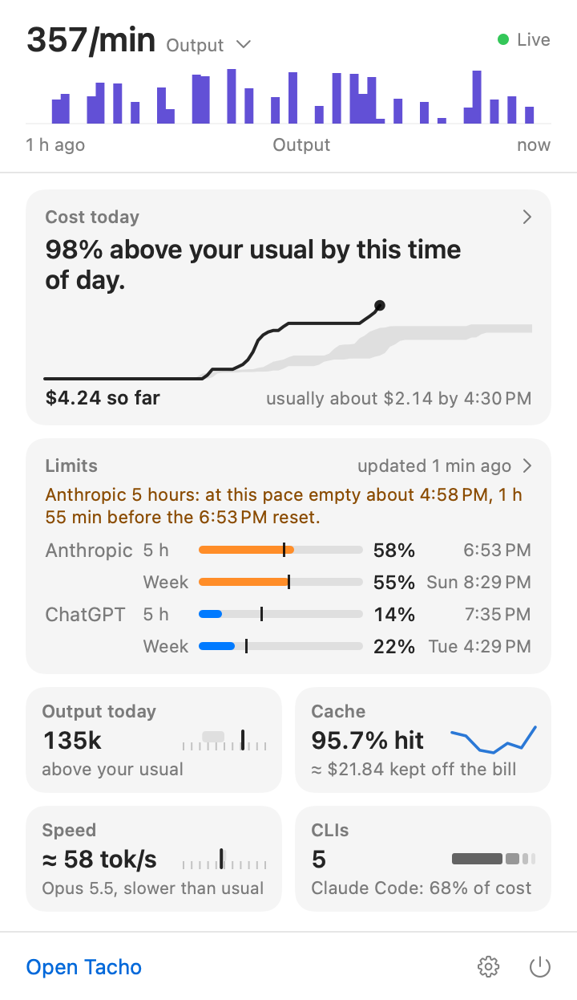
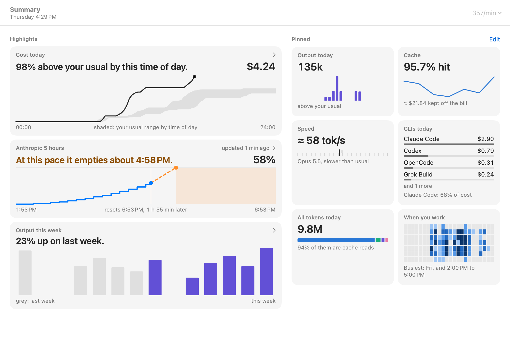
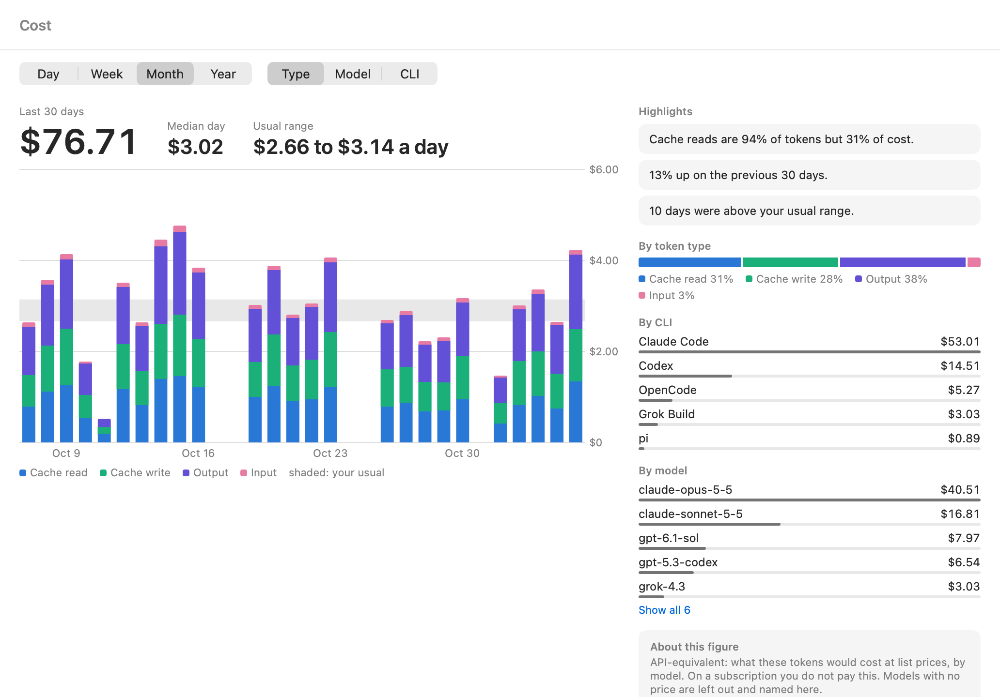
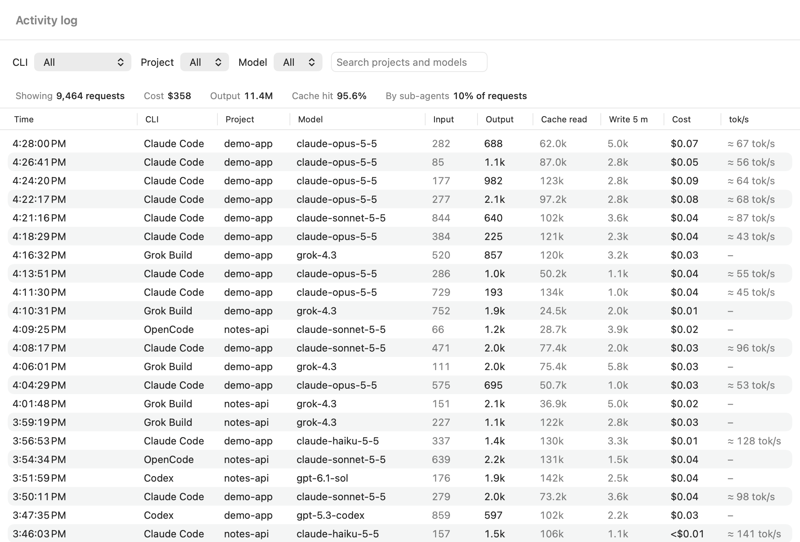
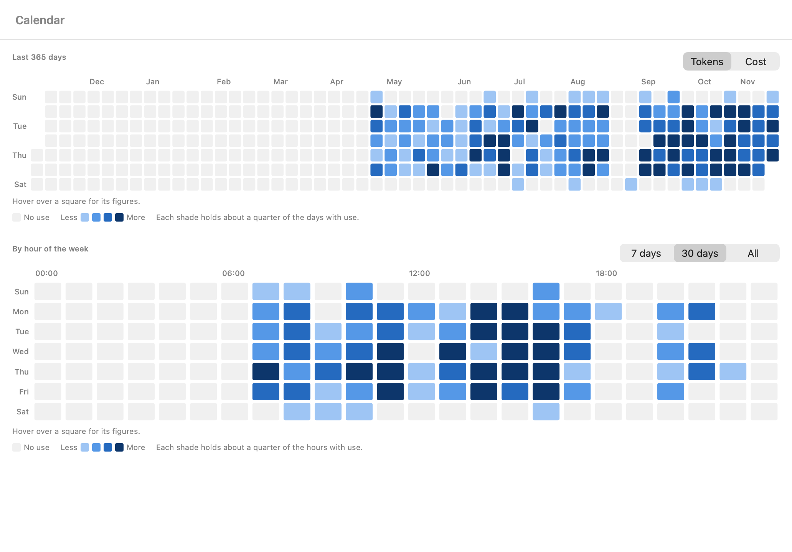

# Tacho

English | [简体中文](README.zh-CN.md)

A native macOS menu bar app that shows how fast your AI coding CLIs are burning tokens, what that would cost on the API, and how long your plan's quota will last. It reads the logs those tools already keep on your Mac, changes none of their files, and never stores your conversations.

Tacho is free and open source, under the MIT license.

## What Tacho shows

The screenshots here use made-up data.



- **Burn rate in the menu bar**, such as `12.4k/min`: the pace of every source you have turned on over the last 5 minutes, shown per minute or per second. There are three rate modes: Output (the default), All tokens, and Cost, which is always dollars per minute. Switch mode from the rate in the panel, from Summary's toolbar, or in Settings. When nothing has happened for 5 minutes it shows only the icon. Settings can also keep the menu bar to the icon, or show Anthropic's 5-hour percentage instead.
- **A panel** under the menu bar item, with the rate and its last 60 minutes, today against your usual range, your limits and one sentence on how they stand, and your pinned cards. Today's card, the limits and each pinned card open the page behind them.
- **Pinned cards:** Output today, Cache, Speed, CLIs, All tokens today and When you work. The panel shows the first four. Summary shows them all, and its Edit button chooses which to keep and in what order.
- **Four token categories:** uncached input, output (with thinking), cache read and cache write. Charts draw cache writes as one layer. The Tokens page and the activity log show 5-minute and 1-hour writes apart, and where Claude records them Tacho prices them separately.
- **API-equivalent cost**, priced per category from each provider's official price page.
- **Quota forecasts** for Anthropic, ChatGPT/Codex and xAI: when you run out at your recent pace, or that you will last until the reset. They cover the 5-hour and weekly windows each provider reports, and Anthropic's weekly limits per model. The icon turns amber when a window is forecast to run out before its reset, and red at 90% estimated use. A figure too old to go on shows no forecast and raises no alert: its row says there is no recent quota data. Sources in use today that have no quota data show an hourly cost instead.
- **Output speed** per model in tokens per second, as a reference figure.



The main window has these pages:

- **Summary:** today against your usual range, the limit most at risk, the last 7 days of output, today so far included, beside the 7 before, and your pinned cards.
- **Limits:** for each limit, what is used, when it resets and, if it would run out first, when, on a chart of the window, with its recent windows and how the forecast was made.
- **Cost, Tokens, Cache and Speed:** each with a Day, Week, Month and Year range.
  - **Cost** charts dollars by token category, gives the median day (or month, on Year), and lists cost by token type, by CLI and by model.
  - **Tokens** charts all tokens by category, or output alone, with its total, and lists all tokens by token type, by CLI and by model.
  - On both, a switch above the chart stacks it by **Type** (the default), **Model** or **CLI**. Model and CLI give the top 5 of the period a layer each, by what the page shows, and merge the rest into Other. On Cost a model with no price has no amount, so it gets no layer, and the note under the chart names it. The usual-range band shows only on Type. By model lists the top 5, and **Show all** opens the rest.
  - **Cache** gives the hit rate, what cache reads kept off the bill, what writes cost, the same range counted by tokens and by cost, and the hit rate of each CLI.
  - **Speed** charts one model's median, beside its usual range and every model's speed.
- **Activity log:** one line per model request (for Grok Build, per model in each turn). Filter by CLI, project or model, or search projects and models; a strip above the table sums up everything that matches. Project is a filter and a column here, and no page breaks figures down by it.
- **Calendar:** a year by day, in tokens or cost, and a week by hour over the last 7 days, 30 days or all time.
- **Settings:** which sources to read and their paths, the price table, the rate mode and unit, the menu bar style, launch at login, the Anthropic quota request, the language (follow the system, English or Simplified Chinese; a change applies after a restart), and rebuilding the index.

Day is the 24 hours of today. Week and Month are the last 7 and 30 days, today so far included, so their figures move through the day. The period before is cut at the same time of day, so a morning does not read as a fall. Year is the last 12 calendar months, this one last. A time on another day says which: `9:00 AM tomorrow`, `Wed 9:00 AM`, or from a week away `Nov 12, 9:00 AM`.

Limits, Cost, Tokens, Cache and Speed also have **highlights**: a few short sentences on what stands out, such as how a period compares with the one before, or how much of your cost is cache reads. A comparison needs a full previous period. When 2% or more of a period's tokens have no price, its cost is too uncertain to build on, so these stay out: how cost compares with the period before, the highlights' shares of cost, days above your usual range, and the median cost. Until Tacho has read all your logs, most of them wait.

Summary, Cost, Tokens, Cache and Speed count only the sources you have turned on, apart from the When you work card. That card, the activity log and Calendar also count sources you have since turned off.







## Supported sources

| Tool | What Tacho reads |
|---|---|
| Claude Code | `~/.claude/projects/**/*.jsonl` |
| Codex | `~/.codex/sessions/**/rollout-*.jsonl` and `.jsonl.zst`, and `~/.codex/archived_sessions/` |
| oh-my-pi | `~/.omp/agent/sessions/**/*.jsonl` |
| pi | `~/.pi/agent/sessions/**/*.jsonl` |
| GitHub Copilot CLI | `~/.copilot/session-state/<id>/events.jsonl` |
| OpenCode | the `message` table of `~/.local/share/opencode/opencode.db` |
| Grok Build | `~/.grok/sessions/<project>/<session>/usage.json` and `~/.grok/logs/unified.jsonl` |

A menu bar app cannot see your shell's `CLAUDE_CONFIG_DIR` or `CODEX_HOME`, so Settings lets you change each source's path or add more.

Three tools keep no token records on your Mac, so Tacho cannot count them. Settings lists any it finds, marked as having no local usage records:

| Tool | Status |
|---|---|
| Gemini CLI | no local token records |
| Qwen Code | no local token records |
| Cursor | no local token records |

Claude Code running inside the Claude desktop app is counted. Chats on claude.ai and in the desktop app are not, because they write no local token records.

## Install

Requires macOS 14 (Sonoma) or later. Tacho targets macOS 14 but has only been run on macOS 26 so far. CI is set up for macOS 15, because GitHub no longer offers macOS 14 runners, so macOS 14 itself is untested.

```sh
brew install --cask gogy717/tap/tacho
```

Or download the zip or dmg from [GitHub Releases](https://github.com/gogy717/tacho/releases).

### First launch

Tacho is unsigned: it carries only an ad-hoc signature, with no Developer ID and no notarization. A downloaded copy, from Homebrew or GitHub, is quarantined, and macOS refuses to open it, perhaps saying the app is damaged. System Settings may offer no way past that, so clear the quarantine flag once, with Tacho in Applications:

```sh
xattr -dr com.apple.quarantine /Applications/Tacho.app
```

That tells macOS to trust this copy, so do it only for a Tacho you got from this project's releases or its Homebrew tap. Then open it as usual.

Tacho then lists the CLIs it found on your Mac, all ticked, and asks which to observe, along with those it cannot watch and why. Until you answer, it reads none of their files. Once you answer, a CLI you untick, or one it did not find, stays off until you turn it on in Settings: its logs and its quota files below are not read. If it finds none, it says so and asks again at the next launch.

Next it asks whether to turn on the [Anthropic quota request](#privacy), which stays off unless you allow it.

Last, it shows its progress through your logs and where to find it. Figures fill in as it reads, so totals rise until it finishes, and comparisons with your usual need 7 days of use.

Tacho needs its menu bar item allowed. On macOS 26 that is under **System Settings → Menu Bar**, in **Allow in the Menu Bar**. If macOS blocks the item, Tacho opens its main window, says so and keeps working there.

## Privacy

**Everything is read-only.** Tacho never writes to any tool's files, and it installs no hook or proxy. SQLite sources are opened read-only, and Tacho checks first so that the `-wal` and `-shm` files beside them are neither created nor changed. SQLite leaves one gap: a `-wal` the tool deletes in the instant between that check and the open comes back empty, as it would on the tool's next start. When a `-wal` cannot be read without changing a file, Tacho reads the database alone, so its newest data can lag.

**It never touches a credential file:** not `~/.codex/auth.json`, `~/.claude/.credentials.json`, `~/.grok/auth.json`, `~/.pi/agent/auth.json`, `~/.local/share/opencode/auth.json` or `~/.gemini/oauth_creds.json`, and not the credential tables in oh-my-pi's `agent.db`. The one exception is the Anthropic quota request below, and only if you turn it on.

**Files read,** beyond the sources above, for quota:

| Provider | Read from |
|---|---|
| Anthropic | `~/.claude.json`, while Claude Code is turned on: the file is parsed and only `cachedUsageUtilization` and `oauthAccount.accountUuid` are kept, and used only when the two account ids match |
| Anthropic, OpenAI, xAI | `~/.omp/agent/agent.db`, while oh-my-pi is turned on: only the `cache` table's `usage_cache:report:*` rows, selecting the `value` column and a yes or no worked out in SQLite: whether the row's key names this Anthropic account. The key itself is not read out. A row for another Anthropic account is ignored |
| OpenAI | the `rate_limits` in Codex's rollouts |
| xAI | the billing lines in `~/.grok/logs/unified.jsonl` |

Anthropic's figures only update when something refreshes them, such as `/usage` or oh-my-pi, and OpenAI's and xAI's update as you use Codex and Grok, so Tacho shows how old each figure is. A 5-hour figure older than 15 minutes, or a weekly one older than an hour, is marked as possibly out of date.

**What is stored:** only numbers, times, models, providers, session ids and project paths. Conversations, prompts, tool arguments and file contents are never stored. The logs Tacho reads do contain your conversations: it parses the lines it needs and takes only what is listed here.

Alongside those figures it keeps a few labels, so it can tell them apart and pick up where it left off:

- which tool each request came from, and whether a sub-agent made it;
- the client (such as `cli`), and the speed tier and region Claude records;
- a key built from ids in the log, to avoid counting a request twice;
- the plan name Codex and oh-my-pi report;
- for each quota figure, its window, the model it is limited to if any, and where it was read from;
- the path of each log file it has read, and how far it got;
- a random id for this install, drawn once and not taken from your Mac's name, its serial number or your user name, to tell its rows from any imported by hand.

All of it stays in `~/Library/Application Support/Tacho/tacho.sqlite` on your Mac. Settings live in macOS preferences, and your price edits in `price-overrides.json` in the same folder.

**The network:** Tacho makes no network connection by default. There are no analytics, no telemetry and no update checks.

**The optional Anthropic quota request:** on first launch Tacho asks whether to use Claude Code's sign-in to check your quota. If you allow it, then every 5 minutes it sends `GET https://api.anthropic.com/api/oauth/usage`, which keeps the quota fresh without `/usage`.

- The token is read with `/usr/bin/security find-generic-password -s "Claude Code-credentials" -w`. macOS may ask you to allow this.
- Only `accessToken` and `expiresAt` are used.
- The token is never refreshed, written back, saved to disk or logged. It goes to `api.anthropic.com` and nowhere else: redirects are refused.
- An expired token is skipped until Claude Code refreshes it, and a 429 waits for the seconds `Retry-After` gives, or 5 minutes if it gives none.

You can turn this off in Settings at any time.

## How the numbers are computed

**Rate.** Tacho takes the events of the last 5 minutes from the sources you have turned on and shows them per minute. Per second is that divided by 60. Output mode, the default, counts output tokens, thinking included. All tokens counts all four categories, including cache reads. Cost is what those tokens would cost at API prices, leaving out any model with no price. A reply counts at the moment it is written to disk, so the figure moves in steps.

**Usual range.** The middle half (p25 to p75) of your newest 14 days with use, from the last 90 days and not counting today. A day with use is one with at least one event from a source you have turned on. It appears after 7 days of use, taken from finished days. Until then Tacho says how many days it has so far, today included once it has use, so on the seventh it says the range appears tomorrow. Speed's is of a model's daily medians, on days with at least 5 timed requests.

**Categories.** Sources record input differently, and some include cached tokens in it. Tacho splits those out, so the four categories never overlap and a total is simply their sum. Output includes thinking.

**Output speed.** Output tokens divided by generation time, as the median per model. Requests under 50 output tokens or 0.5 seconds are ignored. Claude Code records no generation time, so its speed runs from the request to the reply, includes the wait for the first token, and shows as approximate (≈). OpenCode's and Codex's timing includes tool execution, so they get no speed, and neither does Grok Build.

**Cost.** Each category is priced at the provider's list rate, so the figure is what the same tokens would cost on the API, not what you pay on a subscription. Long-context tiers are chosen per request, and Claude's fast mode and US region are priced where Anthropic lists them.

Prices ship in `prices.json`, and every row names its source page and the date it was read:

| Provider | Source | Read on |
|---|---|---|
| Anthropic | https://platform.claude.com/docs/en/about-claude/pricing | 2026-11-03 |
| OpenAI | https://platform.openai.com/docs/pricing | 2026-11-03 and 2026-11-05 |
| xAI | https://docs.x.ai/docs/models | 2026-11-03 and 2026-11-05 |

- **Promotional prices.** `gpt-5.6-sol` carries a promotional price dated 2026-11-03. OpenAI says it is available at least through November 21, 2026, so re-read it after 2026-11-21. `gpt-6-astra-law` is also promotional, at least through December 31, 2026.
- **A model with no row has no price.** It shows "no price", stays out of the total, and the total says which models it left out. That covers models whose provider publishes no price, such as `codex-auto-review`, and models whose published price has a gap, such as `gpt-5.5-pro` (no cached-input rate) and `gpt-5.6-cyber` (no long-context rate). One model's price is never used for another, with two exceptions: xAI publishes no price for `grok-4.7-build` or `grok-4.7-build-fast`, so the first is priced as Grok 4.7 by the project's decision, and the second at twice that, as the Grok CLI shows. Their rows in Settings say so.
- **One assumption.** Where OpenAI or xAI list no cache-write rate, Tacho charges a cache write at the model's input rate.
- You can change any row, or add one, in Settings.

**Forecasts.** For each provider and window, Tacho takes the latest quota figure: U% used, with its reset time.

1. It compares U with what this Mac spent in the window up to that figure, which gives how many percentage points each dollar is worth (or each token, when a model in the window has no price).
2. Spending since that figure was taken moves the estimate forward, which is why an old figure shows as approximate.
3. Your pace over the last 30 minutes then gives the time left. If that is past the reset, Tacho says you will last until the reset. If you have used nothing in those 30 minutes, it says you are not using it right now.
4. With no local usage in the window, or under 1% used, it falls back to the used percentage over the time elapsed, and says so. Past its reset a figure no longer counts: the estimate starts again from 0% plus what this Mac has used since.
5. Once a full window has passed since that reset, the figure says nothing about now. Tacho keeps the row but gives no estimate or forecast, says there is no recent quota data, and raises no alert from it, for every provider alike.

Tacho knows only 5-hour and weekly windows. A plan measured over any other period, such as the 30-day window of Codex's free plan or a monthly Grok account, gets no new figures, so its older ones end this way. Tacho does not record which Claude account a quota figure came from, so after you switch accounts the old account's last figure stays on show until a new one arrives or it ages out.

**The forecast tends to run early.** Tacho cannot see usage on other devices, on claude.ai or in desktop chat, so it credits all of a window's use to what it can see on this Mac, and each local token looks more expensive than it is. API-key traffic through oh-my-pi, pi or OpenCode uses no subscription quota but counts by default; each source has a "Count toward quota forecasts" checkbox in Settings.

## Uninstall

```sh
brew uninstall --zap --cask tacho
```

Without Homebrew, quit Tacho first, so it cannot write its preferences back. Then delete `Tacho.app` and remove its data and preferences:

```sh
rm -rf ~/Library/Application\ Support/Tacho
defaults delete io.github.gogy717.tacho
```

## Build from source

You need Swift 6.1 or later, which comes with Xcode 16.3.

```sh
swift test
scripts/bundle.sh 0.1.0
```

`scripts/bundle.sh` builds a universal, ad-hoc signed `build/Tacho.app`, with `build/Tacho-0.1.0.zip` and `build/Tacho-0.1.0.dmg` beside it.

Tacho does not sync between machines. The package also builds `tacho-cli`, which is not in the app: its `export` and `import` move a batch of usage by hand, and [docs/design/sync.md](docs/design/sync.md) says what a batch holds and what it leaves out.

## Acknowledgements

- **glassbox**, whose parsing rules, de-duplication rules and quota sources Tacho's readers follow.
- **ClaudeBar**, the inspiration for a free menu bar app distributed through GitHub and Homebrew.

## License

MIT. See [LICENSE](LICENSE). Tacho includes GRDB and Zstandard, whose licenses are in [THIRD-PARTY-NOTICES.md](THIRD-PARTY-NOTICES.md), which also ships inside the app.
