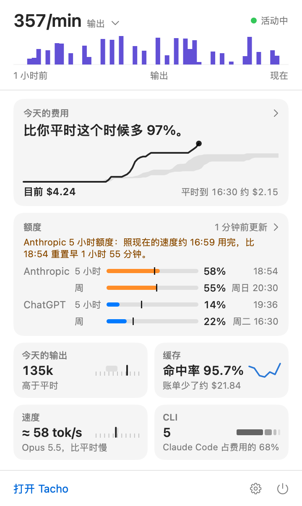
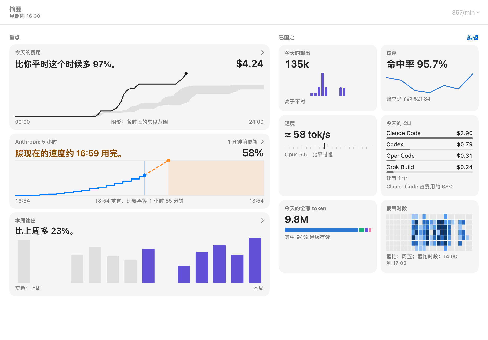
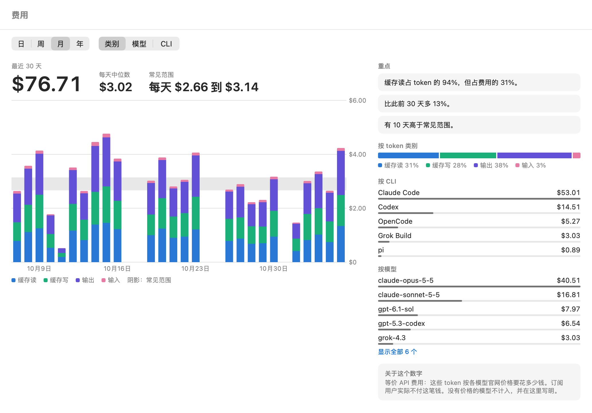
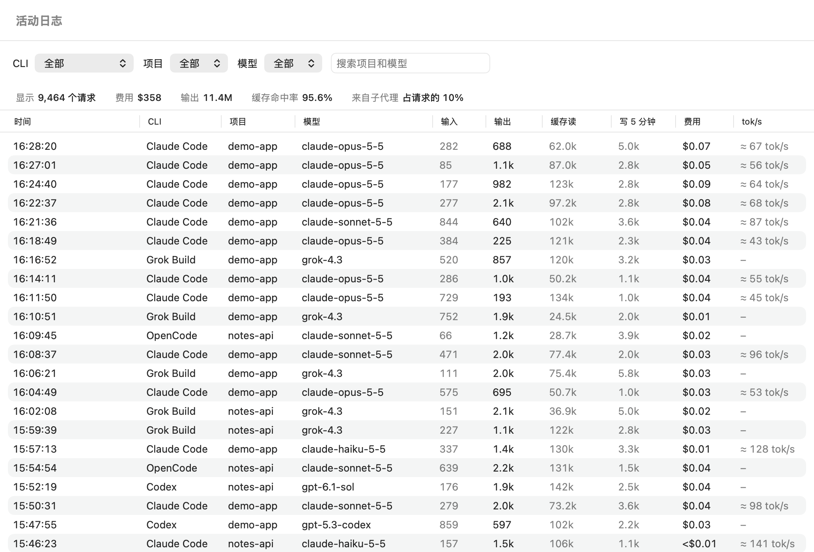
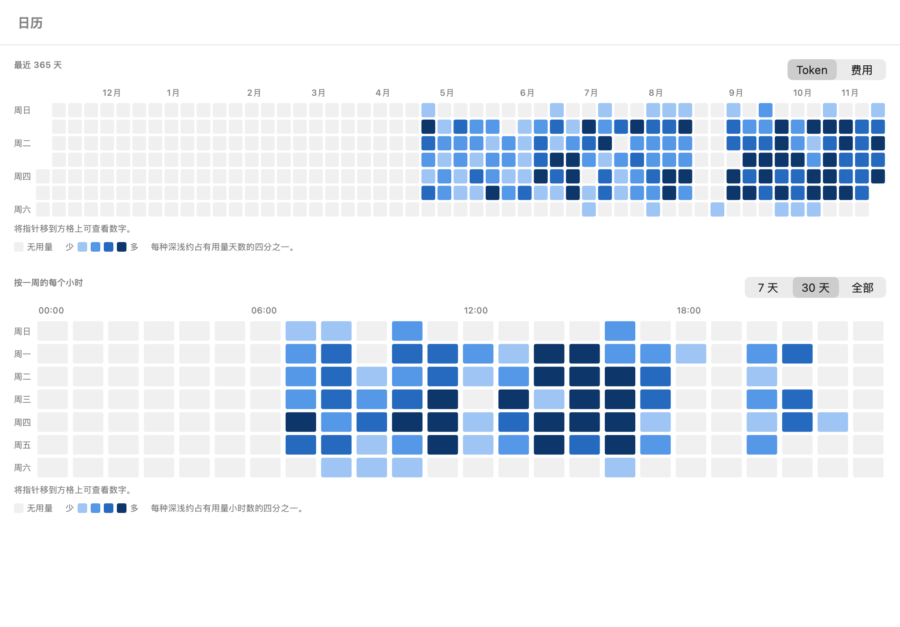

# Tacho

[English](README.md) | 简体中文

一个原生的 macOS 菜单栏 app：看你的 AI 编程 CLI 消耗 token 有多快，这些 token 按 API 价算要多少钱，套餐额度还能撑多久。它读的是这些工具本来就存在你 Mac 上的日志，不改动它们的任何文件，也从不保存你的对话。

Tacho 免费开源，采用 MIT 许可。

## Tacho 显示什么

这里的截图用的都是虚构数据。



- **菜单栏里的消耗速率**，比如 `12.4k/min`：你开启的所有来源最近 5 分钟的速度，可以按每分钟或每秒显示。速率有三种模式：输出（默认）、全部 token 和费用，费用始终是每分钟的美元。可以在面板的速率上、摘要的工具栏里或设置里切换。5 分钟内没有动静时只显示图标。设置里还可以让菜单栏只显示图标，或改为显示 Anthropic 的 5 小时百分比。
- **面板**：在菜单栏图标下方，有速率和最近 60 分钟的走势、今天和你常见范围的对比、额度和一句现状说明，以及已固定的卡片。今天的卡片、额度和每张已固定的卡片都能打开对应的页面。
- **已固定的卡片**：今天的输出、缓存、速度、CLI、今天的全部 token 和使用时段。面板显示前四张。摘要显示全部，用它的编辑按钮选择保留哪些、按什么顺序排列。
- **四类 token**：未缓存输入、输出（含思考）、缓存读、缓存写。图表把缓存写画成一层。Token 页和活动日志把 5 分钟和 1 小时两档分开显示；Claude 记录了这两档时，Tacho 分别计价。
- **等价 API 费用**：四类 token 按各家官网价目分别计价。
- **额度预测**：针对 Anthropic、ChatGPT/Codex 和 xAI，告诉你照最近的速度什么时候用完，或者能撑到重置。范围是各服务商报告的 5 小时和每周窗口，以及 Anthropic 按模型的每周额度。预测某个窗口会在重置前用完时，图标变琥珀色；估计用量达到 90% 时变红。太旧的数字不再给预测，也不触发警示：这一行会写明没有近期额度数据。今天在用但没有额度数据的来源改为显示每小时费用。
- **输出速度**：每个模型的输出 tok/s，作为参考指标。



主窗口有这些页面：

- **摘要**：今天和你常见范围的对比、风险最高的额度、最近 7 天（含今天到现在）的输出和再往前 7 天的对比，以及已固定的卡片。
- **额度**：每个额度的已用量、什么时候重置，以及如果会提前用完，是什么时候，配一张这个窗口的图，还有它最近的窗口和预测是怎么算出来的。
- **费用、Token、缓存和速度**：每页都有日、周、月、年四种范围。
  - **费用**按 token 类别画出美元，给出每天中位数（年范围下是每月中位数），并按 token 类别、CLI 和模型列出费用。
  - **Token** 按类别画出全部 token，或只画输出，并给出总数；全部 token 按 token 类别、CLI 和模型列出。
  - 这两页的图表上方有一个开关，可按**类别**（默认）、**模型**或 **CLI** 堆叠。按模型和按 CLI 时，这段时间排名前 5 的各占一层（按当前页显示的数字排），其余并入“其他”。在费用页，没有价格的模型没有金额，所以不占一层，图表下方的说明会写明它。常见范围的色带只在按类别时显示。按模型列表先显示前 5 个，点**显示全部**看其余。
  - **缓存**给出命中率、缓存读让账单减少了多少、写入缓存的费用、同一范围分别按 token 和按费用算的结果，以及每个 CLI 的命中率。
  - **速度**画出一个模型的中位数，旁边是它的常见范围和每个模型的速度。
- **活动日志**：每次模型请求一行（Grok Build 是每轮每个模型一行）。可以按 CLI、项目或模型筛选，也可以搜索项目和模型；表格上方的一栏汇总所有匹配的内容。项目在这里是筛选条件和一列，没有哪个页面按项目拆分数字。
- **日历**：一年按天的格子，可看 token 或费用，加一周按小时的格子，范围可选最近 7 天、30 天或全部。
- **设置**：读取哪些来源及其路径、价目表、速率模式和单位、菜单栏显示方式、登录时打开、Anthropic 额度查询、语言（跟随系统、英文或简体中文，改动重启后生效），以及重建索引。

日是今天的 24 小时。周和月是最近 7 天和最近 30 天，今天到现在的部分也算在内，所以这些数字在一天里会变动。上一周期截到同一时刻，所以早上不会显得用量下降。年是最近 12 个自然月，本月排在最后。不在今天的时间会写明是哪天：`明天 09:00`、`周三 09:00`，一周以外写日期，比如 `11月12日 09:00`。

额度、费用、Token、缓存和速度还有**重点**：几句简短的话，说明哪里值得注意，比如这段时间和上一段相比如何，或缓存读占了你多少费用。对比需要一个完整的上一周期。一段时间里没有价格的 token 达到 2% 时，它的费用太不确定，不足以作为依据，所以这些不出现：和上一周期对比的费用、重点里的费用占比、高于常见范围的天数，以及费用中位数。Tacho 读完所有日志之前，大多数重点都会等待。

摘要、费用、Token、缓存和速度只计你开启的来源，使用时段卡片除外。这张卡片、活动日志和日历也会算上后来关掉的来源。







## 支持的来源

| 工具 | Tacho 读取的内容 |
|---|---|
| Claude Code | `~/.claude/projects/**/*.jsonl` |
| Codex | `~/.codex/sessions/**/rollout-*.jsonl` 和 `.jsonl.zst`，以及 `~/.codex/archived_sessions/` |
| oh-my-pi | `~/.omp/agent/sessions/**/*.jsonl` |
| pi | `~/.pi/agent/sessions/**/*.jsonl` |
| GitHub Copilot CLI | `~/.copilot/session-state/<id>/events.jsonl` |
| OpenCode | `~/.local/share/opencode/opencode.db` 的 `message` 表 |
| Grok Build | `~/.grok/sessions/<项目>/<会话>/usage.json` 和 `~/.grok/logs/unified.jsonl` |

菜单栏 app 读不到 shell 里的 `CLAUDE_CONFIG_DIR` 和 `CODEX_HOME`，所以你可以在设置里修改每个来源的路径，也可以多加几个。

有三个工具不在 Mac 上保存 token 记录，Tacho 没法统计。设置里会列出找到的工具，注明本地没有用量记录：

| 工具 | 状态 |
|---|---|
| Gemini CLI | 本地没有 token 记录 |
| Qwen Code | 本地没有 token 记录 |
| Cursor | 本地没有 token 记录 |

在 Claude 桌面版里运行的 Claude Code 会计入。claude.ai 网页版和桌面版里的聊天不计入，因为它们不写本地 token 记录。

## 安装

需要 macOS 14（Sonoma）或更新版本。Tacho 以 macOS 14 为目标，但目前只在 macOS 26 上运行过。CI 配置的是 macOS 15，因为 GitHub 已经不再提供 macOS 14 的运行器，所以 macOS 14 本身还没有测试过。

```sh
brew install --cask gogy717/tap/tacho
```

也可以从 [GitHub Releases](https://github.com/gogy717/tacho/releases) 下载 zip 或 dmg。

### 第一次打开

Tacho 没有正式签名：只有 ad-hoc 签名，没有 Developer ID，也没有经过公证。下载的副本（无论来自 Homebrew 还是 GitHub）会被隔离，macOS 会拒绝打开，可能还会提示应用已损坏。系统设置里不一定有绕过的办法，所以把 Tacho 放进“应用程序”后，清除一次隔离标记：

```sh
xattr -dr com.apple.quarantine /Applications/Tacho.app
```

这等于告诉 macOS 信任这份副本，所以只对从本项目的 Releases 或 Homebrew tap 得到的 Tacho 这样做。之后照常打开即可。

接着 Tacho 列出在你 Mac 上找到的 CLI，默认全部勾选，问要观察哪些，同时列出无法观察的工具和原因。你回答之前，它不读这些工具的任何文件。你回答之后，取消勾选的和没找到的 CLI 都保持关闭，直到你在设置里打开：它们的日志和下面的额度文件都不读。如果一个都没找到，它会告诉你，并在下次启动时再问。

然后它问要不要开启 [Anthropic 额度查询](#隐私)，你不同意就一直关着。

最后它显示读取日志的进度，并告诉你到哪里找它。数字边读边出现，所以读完之前总数还会上升；和常见范围的对比要用满 7 天才有。

Tacho 需要菜单栏图标获得允许。在 macOS 26 上，这在**系统设置 → 菜单栏**的**允许在菜单栏显示**里。如果 macOS 拦下了菜单栏图标，Tacho 会打开主窗口告诉你，并继续在主窗口里工作。

## 隐私

**全部只读。** Tacho 不写任何工具的文件，也不安装 hook 或代理。SQLite 来源以只读方式打开，Tacho 会先做检查，确保不创建也不改动旁边的 `-wal` 和 `-shm` 文件。SQLite 留下了一个缺口：如果工具恰好在检查和打开之间的一瞬间删掉了 `-wal`，这个文件会被重新建成空文件，和工具下次启动时一样。如果读 `-wal` 就得改动文件，Tacho 只读数据库本身，这时最新的数据可能会滞后。

**不碰任何凭据文件：** 包括 `~/.codex/auth.json`、`~/.claude/.credentials.json`、`~/.grok/auth.json`、`~/.pi/agent/auth.json`、`~/.local/share/opencode/auth.json`、`~/.gemini/oauth_creds.json`，以及 oh-my-pi 的 `agent.db` 里的凭据表。唯一的例外是下面的 Anthropic 额度查询，而且只有你开启后才会发生。

**除了上面的来源，为了额度还会读这些文件：**

| 服务商 | 读取位置 |
|---|---|
| Anthropic | `~/.claude.json`，Claude Code 开启时：解析整个文件，只保留 `cachedUsageUtilization` 和 `oauthAccount.accountUuid`，两边的账号 id 一致才使用 |
| Anthropic、OpenAI、xAI | `~/.omp/agent/agent.db`，oh-my-pi 开启时：只读 `cache` 表里 `usage_cache:report:*` 的行，选出 `value` 列，以及 SQLite 里算出的一个是或否：这一行的 key 是否属于当前 Anthropic 账号。key 本身不会读出来。属于其他 Anthropic 账号的行不使用 |
| OpenAI | Codex 日志里的 `rate_limits` |
| xAI | `~/.grok/logs/unified.jsonl` 里的计费行 |

Anthropic 的数字只有在被刷新时才更新，比如运行 `/usage` 或 oh-my-pi；OpenAI 和 xAI 的数字在你使用 Codex 和 Grok 时更新。所以 Tacho 会显示每个数字是多久之前的。5 小时的数字超过 15 分钟、每周的数字超过 1 小时，就标为可能过时。

**存了什么：** 只存数字、时间、模型、提供方、会话 id 和项目路径，不存对话、提示词、工具参数和文件内容。Tacho 读的日志里确实有你的对话：它解析需要的那些行，只取这里列出的内容。

除了这些数字，它还保存几个标签，用来区分数据，并从上次读到的地方接着读：

- 每次请求来自哪个工具，以及是不是子代理发出的；
- 客户端（比如 `cli`），以及 Claude 记录的速度档位和地区；
- 由日志里的 id 组成的键，防止重复计数；
- Codex 和 oh-my-pi 报告的套餐名称；
- 每个额度数字的窗口、它只限于哪个模型（如果有），以及从哪里读到的；
- 读过的每个日志文件的路径，以及读到了哪里；
- 这次安装的随机 id：只生成一次，不取自电脑名、序列号或用户名，用来把本机的记录和手动导入的记录区分开。

这些都留在你 Mac 上的 `~/Library/Application Support/Tacho/tacho.sqlite`。设置存在 macOS 的偏好设置里，你改过的价目存在同一目录的 `price-overrides.json`。

**联网：** Tacho 默认不联网。没有统计，没有遥测，没有更新检查。

**可选的 Anthropic 额度查询：** 第一次启动时，Tacho 会问要不要用 Claude Code 的登录查询额度。如果你同意，它每 5 分钟发送一次 `GET https://api.anthropic.com/api/oauth/usage`，这样不用运行 `/usage` 额度也能保持最新。

- token 用 `/usr/bin/security find-generic-password -s "Claude Code-credentials" -w` 读出，macOS 可能会请你允许。
- 只使用 `accessToken` 和 `expiresAt`。
- token 不刷新、不写回、不落盘、不打日志。它只发给 `api.anthropic.com`，不接受重定向。
- token 过期就跳过，等 Claude Code 自己刷新；遇到 429 就按 `Retry-After` 给的秒数等待，没给秒数就等 5 分钟。

你随时可以在设置里关掉它。

## 数字是怎么算的

**速率。** Tacho 取你开启的来源最近 5 分钟内的事件，按每分钟显示。每秒是这个数除以 60。默认的输出模式只算输出 token，含思考。全部 token 模式四类都算，包括缓存读。费用模式是这些 token 按 API 价算的钱，不计没有价格的模型。一次回复在写入磁盘的那一刻才计入，所以读数是一格一格变的。

**常见范围。** 你最近 14 个有使用的日子的中间一半（p25 到 p75），取自最近 90 天，不含今天。有使用的日子是指你开启的来源至少有一个事件的那一天。用满 7 天后才出现，只取已结束的日子。在那之前 Tacho 会告诉你目前有多少天，今天有使用后也算在内，所以第七天它会说明天起会有常见范围。速度的常见范围取自模型每天的中位数，只算至少有 5 次计时请求的日子。

**四类 token。** 各来源记录输入的方式不同，有的把缓存算在输入里。Tacho 会把这部分拆出来，所以四类互不重叠，总数就是四类相加。输出包含思考。

**输出速度。** 输出 token 除以生成时长，每个模型取中位数。输出少于 50 个 token 或时长不到 0.5 秒的请求不计。Claude Code 不记录生成时长，所以它的速度从请求算到回复，包含等待第一个 token 的时间，并标为约数（≈）。OpenCode 和 Codex 的时长里混进了工具执行时间，所以不计算速度；Grok Build 也不计算。

**费用。** 每一类都按服务商的官网标价计算，所以这个数字是同样的 token 走 API 要花多少钱，不是你订阅实际付的钱。长上下文档位按单次请求判断；Anthropic 列出价格的 Claude fast 模式和美国地区也会分别计价。

价格随 app 打包在 `prices.json` 里，每一行都写明来源网页和读取日期：

| 服务商 | 来源 | 读取日期 |
|---|---|---|
| Anthropic | https://platform.claude.com/docs/en/about-claude/pricing | 2026-11-03 |
| OpenAI | https://platform.openai.com/docs/pricing | 2026-11-03 和 2026-11-05 |
| xAI | https://docs.x.ai/docs/models | 2026-11-03 和 2026-11-05 |

- **促销价。** `gpt-5.6-sol` 是促销价，日期为 2026-11-03。OpenAI 说这个价格至少到 2026 年 11 月 21 日，所以 2026-11-21 之后要重新核对。`gpt-6-astra-law` 也是促销价，至少到 2026 年 12 月 31 日。
- **没有价目就没有价格。** 这样的模型显示"无价格"，不计入总价，总价旁边会写明没算哪些模型。这包括官方没有公布价格的模型，比如 `codex-auto-review`；也包括公布的价格有缺项的模型，比如 `gpt-5.5-pro`（没有缓存输入价）和 `gpt-5.6-cyber`（没有长上下文价）。绝不拿一个模型的价格给另一个模型计价，只有两个例外：xAI 没有公布 `grok-4.7-build` 和 `grok-4.7-build-fast` 的价格，前者按项目的决定取 Grok 4.7 的价格，后者是它的两倍，和 Grok CLI 显示的一样。设置里这两行写明了这一点。
- **一个假设。** OpenAI 或 xAI 没有列出缓存写价格时，Tacho 按该模型的输入价计算缓存写。
- 你可以在设置里修改任意一行，或者新增一行。

**预测。** 对每个服务商的每个窗口，Tacho 取最新的额度数字：已用 U%，以及重置时间。

1. 把 U 和这台 Mac 在窗口内截至这个数字时已花的费用比较，得出每一美元相当于多少个百分点（窗口里有无价格的模型时，改按 token 算）。
2. 这个数字之后的消耗会把估计值往前推，所以较旧的数字会显示为约数。
3. 再用最近 30 分钟的速度算出还能用多久。如果晚于重置时间，就显示能撑到重置。如果这 30 分钟里没有用量，就显示现在没在用。
4. 窗口内本机没有用量，或者已用不到 1% 时，改用已用百分比除以已过时间来外推，并在界面上注明。过了重置时间的数字作废，估计值从 0% 加上重置之后本机的用量重新算起。
5. 重置之后再过一整个窗口，这个数字就说明不了现在的情况。Tacho 保留这一行，但不给估计和预测，写明没有近期额度数据，也不因它触发警示，所有服务商都一样。

Tacho 只认 5 小时和每周窗口。按其他周期计算的套餐，比如 Codex 免费版的 30 天窗口或按月计费的 Grok 账号，不会有新数字，旧数字最后也会变成这样。Tacho 不记录额度数字来自哪个 Claude 账号，所以切换账号之后，旧账号最后的数字会一直显示，直到有新数字或者它过期。

**预测往往偏早。** Tacho 看不到其他设备、claude.ai 和桌面版聊天用掉的额度，只能把窗口里的全部用量都算在这台 Mac 看得到的部分上，所以本机每个 token 看起来比实际更贵。经 oh-my-pi、pi 或 OpenCode 走 API key 的请求不消耗订阅额度，但默认也会计入；每个来源在设置里都有一个"计入额度预测"复选框。

## 卸载

```sh
brew uninstall --zap --cask tacho
```

没用 Homebrew 的话，先退出 Tacho，免得它把偏好设置写回去。然后删掉 `Tacho.app`，再清除数据和偏好设置：

```sh
rm -rf ~/Library/Application\ Support/Tacho
defaults delete io.github.gogy717.tacho
```

## 从源码构建

需要 Swift 6.1 或更新版本（Xcode 16.3 自带）。

```sh
swift test
scripts/bundle.sh 0.1.0
```

`scripts/bundle.sh` 会构建 universal、ad-hoc 签名的 `build/Tacho.app`，并在同一目录生成 `build/Tacho-0.1.0.zip` 和 `build/Tacho-0.1.0.dmg`。

Tacho 不在机器之间同步。这个包还会构建 `tacho-cli`，它不在应用里：用它的 `export` 和 `import` 可以手动搬运一批用量，[docs/design/sync.md](docs/design/sync.md) 写明了一批数据包含什么、不包含什么。

## 致谢

- **glassbox**：Tacho 的读取器沿用了它的解析规则、去重规则和额度来源。
- **ClaudeBar**：启发了"免费的菜单栏 app，通过 GitHub 和 Homebrew 发布"这种做法。

## 许可

MIT。见 [LICENSE](LICENSE)。Tacho 包含 GRDB 和 Zstandard，它们的许可证在 [THIRD-PARTY-NOTICES.md](THIRD-PARTY-NOTICES.md) 里，这个文件也随 app 一起发布。
