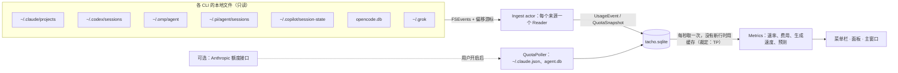

# Tacho 设计文档

日期：2026-11-03　·　状态：已实现。2026-11-05 逐节对照代码核对过（TSPEC）：文中写了、代码里没有的标了【未做】；代码不符合要求、已经安排修的，正文照旧写要求，清单在 SDD 工作区的 `task-tspec-report.md` 和 `progress.md`。

标注：**【用户】** 用户的原话或用户做的选择；**【已确认】** 我提议、用户确认过的；**【我定】** 我替用户做的决定，用户可以推翻；**【未验证】** 还没实测的假设；**【未做】** 文中写了、代码里没有的；**（裁定：X）** 这句话按 `progress.md` 里的裁定 X 改过。标着【用户】的话不改，受影响的地方指到文末"用户确认的变更"。

---

## 1. 为什么做

【用户】想要一个通用 coding CLI 的 token 速度监控：

- 区分 token 来源；
- 计算每秒、每分钟的 token 速度；
- token 分成输入、输出、缓存；
- 按官网价格算等价 API 费用；
- 做成开源 Mac app，借鉴 ClaudeBar 的运营模式但不抄它；能看 token 用量和预期使用时间（5 小时 / 1 周窗口）；
- 能看活动日志、热力图。

现状（2026-11-03 在本机实测）：

- 本机有 7 个工具在本地写 token 记录：Claude Code、Codex（CLI 和桌面版）、oh-my-pi（下称 omp）、pi、GitHub Copilot CLI、OpenCode、Grok Build。Gemini CLI、Qwen Code、Cursor 在本地没有 token 记录。
- 用户自己的 glassbox（`~/projects/glassbox`，MIT）是浏览器里的会话查看器。它已经有 Claude Code、Codex、Grok、omp、OpenCode 的解析和去重规则、额度来源和 Anthropic 价目表，顶栏有按 CLI 和类型拆开的"每分钟 token 速率"。但它要开着浏览器，重心是单个会话。
- 本机在跑 ClaudeBar v0.5.24（tddworks，Apache-2.0）：额度百分比、节奏预测、每日费用图、年度热力图、多服务商。它不显示速度。

所以 Tacho 的定位是：**常驻菜单栏、以"消耗速率"为主角**的跨 CLI token 仪表。名字取自转速表（tachometer）：每分钟 token 数就是 AI 编码的"转速"。【用户】选定名字 Tacho。

## 2. 目标、非目标、反目标

### 目标

1. 【用户】【已确认】菜单栏常驻显示**消耗速率**：最近 1 分钟内所有来源合计的 token 数，默认单位"每分钟"（如 `12.4k/min`），可切换为每秒。速率的模式和窗口见文末"用户确认的变更"第 6、8 条。"所有来源"指开启的来源（裁定：Task 15b）。
2. 【用户】按**来源**拆分：CLI（以及 CLI 内的客户端，如 Claude Code 的终端、桌面版、VS Code、SDK，Codex 的 CLI 和桌面版）、模型、项目。主界面不按项目分组，项目只留在活动日志里，见文末第 11 条。
3. 【用户】【已确认】按**四类**拆分：未缓存输入、输出（含思考）、缓存读、缓存写；缓存写再分 5 分钟和 1 小时两档。
4. 【已确认】**生成速度**：每个模型的输出 tok/s，作为面板里的参考指标。面板现在只显示样本最多的那个模型，全部模型在速度页，见文末第 9 条。
5. 【用户】**等价 API 费用**：四类 token 按各家官网价目分别计价。
6. 【用户】【已确认】**预期使用时间**：对有额度数据的服务商（Anthropic、ChatGPT/Codex、xAI），5 小时和每周两个窗口各给一句"照最近的消耗速度，约 X 后用完"或"能撑到重置"。没有额度数据的来源只显示每小时花费。一句话现在只给规则挑出来的那个窗口，其余窗口显示百分比和重置时间，见文末第 9 条。
7. 【用户】【已确认】**活动日志**：每次模型请求一行。
8. 【用户】【已确认】**热力图**：一年按天的格子，加一周 7×24 按小时的格子。
9. 【用户】开源、Mac 原生 app，借鉴 ClaudeBar 的运营模式：免费、GitHub 发布、Homebrew 安装、中英双语 README。【未做】v0.1 还没有发布，见 §5.10。

### 非目标（v1 不做）

- 【已确认】不支持本地没有 token 记录的工具（Gemini CLI、Qwen Code、Cursor）。设置页列出它们，写明"本地没有用量记录"。只列目录存在的（裁定：TSPEC 第 12 项）。
- 【已确认】不做通知，不做排行榜。
- 不做代理或抓包，不装 hook。不统计 claude.ai 网页版和 Claude 桌面版里的聊天用量：它们不写本地 token 记录。桌面版里跑的 Claude Code（Code 模式）要算，见 §5.3。
- 不计非 token 费用（如 web search 按次收费）。
- 不做 Windows、Linux 版。Linux 上的例外只是无界面采集器，见文末"用户确认的变更"第 17 条。
- v1 不做自动更新（见 §5.10）。

### 反目标（做出来也算失败的情况）

- **改动任何 CLI 的文件**：写 `settings.json`、装 hook、写 `~/.claude.json`、刷新或写回 OAuth token（刷新会轮换 token，可能把 CLI 登出）。
- **读取或保存对话内容**：只取 token 数、时间、模型、提供方、会话 id、项目路径。
- **数字不可信**：重复计数（Claude 一条回复写成多行、Codex 累计值重放、omp/pi 分叉重放），把"已含缓存的输入"再加一遍缓存，拿别的模型的价格给无价格的模型计价（例外只有用户决定的两个，见文末第 15、16 条），把过时的额度当成新的。宁可显示"无价格""数据 X 分钟前"，也不给错的数。
- **抄 ClaudeBar**：不复制它的代码、资源、界面布局、文案、provider 定义；不用它在 PTY 里跑 `claude /usage` 的取数法；名字不用 "*Bar"。
- **常驻成本高**：菜单栏 app 不能明显耗电、耗内存（预算见 §5.11）。
- 未经用户同意联网。

## 3. 约束

- 平台：macOS 14 及以上【我定】（`@Observable`、`MenuBarExtra`、Swift Charts 都可用）。本机是 macOS 26.6.2、Xcode 27.2、Swift 6.4.2。Swift 下限见文末"用户确认的变更"第 4 条。
- 不进沙盒：要读 `~/.claude` 等目录，所以上不了 Mac App Store。
- 签名：用户只有 Apple Development 证书，没有 Developer ID，做不了公证。官方 homebrew/cask 会下架通不过 Gatekeeper 的 app，所以先用个人 tap 发布；ad-hoc 签名的 app 被隔离时 Gatekeeper 会拒绝，"仍要打开"靠不住，所以用户第一次打开前要清除隔离标记：`xattr -dr com.apple.quarantine /Applications/Tacho.app`。
- 各 CLI 的本地格式都是内部格式，会随版本变。每个来源都要"认不出就跳过并计数"，不能崩。
- 数据量：本机 `~/.claude/projects` 约 1.7 GB，`~/.codex/sessions` 约 262 MB（旧会话压缩成 `.jsonl.zst`），omp 单个会话可达 3400 万 token。
- Claude Code 要等一次回复全部生成完才写盘，所以速率只能按已完成的请求计。
- 许可：MIT【我定】（与 glassbox 一致）。glassbox 是用户自己的 MIT 项目，规则和代码都可以移植；ClaudeBar 只作"别人做过什么"的参考。

## 4. 做法

考虑过三种：

| | 做法 | 好处 | 代价 |
|---|---|---|---|
| **A（选定）** | 原生 Swift 单体 app：SwiftUI + Swift Charts；7 个来源的解析器用 Swift 写，规则从 glassbox 移植；SQLite 存每次请求；FSEvents 增量读取 | 体积小（约 10 MB），空闲时几乎不耗 CPU，界面原生 | 解析器要重写；Codex 的旧会话要自带 zstd 解压 |
| B | Swift 外壳 + 用 Bun 编译的 glassbox TS 内核做子进程 | 复用 5 个现成的解析器和测试 | 多 60–100 MB，常驻 JS 运行时约 100 MB 内存；glassbox 的解析器连对话内容一起解析，太重；pi、Copilot 还得另写 |
| C | Tauri（Rust 内核 + 网页界面） | 复用 glassbox 的 React 界面，以后能跨平台 | 菜单栏面板不原生，WebView 占内存，解析器照样要重写；用户要的是 Mac app |

【用户】选 A。理由：常驻菜单栏的东西必须轻；glassbox 里真正值钱的是解析规则，不是它的运行时。

## 5. 设计

### 5.1 结构【我定】

一个 SwiftPM 包，三个 target：

- `TachoKit`（库）：来源解析、存储、指标、价目、额度。不依赖 SwiftUI，可以单独测试。
- `Tacho`（app）：SwiftUI 界面，`MenuBarExtra` + 主窗口。
- `tacho-cli`（调试用）：`scan`、`stats`、`rate`、`quota`、`speeds`、`reconcile` 几个子命令，把 TachoKit 算出的数打到终端，用于冒烟和对账。

`scripts/bundle.sh` 把 `Tacho` 打包成 `Tacho.app`：Info.plist 里设 `LSUIElement=YES`，加图标，做 ad-hoc 签名。不提交 `.xcodeproj`，开发时用 Xcode 直接打开 `Package.swift`。

依赖只有两个：GRDB.swift（SQLite）和一个 zstd 解码库（见 §6）。其余都用系统框架。

### 5.2 统一的数据：UsageEvent

每次模型请求一条（Grok 只按轮记录，就每轮每个模型一条）：

| 字段 | 含义 |
|---|---|
| `source` | `claudeCode` / `codex` / `omp` / `pi` / `copilot` / `opencode` / `grok` |
| `client` | 来源内的客户端，如 Codex 的 `codex-tui`（CLI）和 `codex_work_desktop`（桌面版）；没有就留空 |
| `dedupKey` | 全局唯一，规则见各来源 |
| `sessionId`、`project`（cwd）、`isSubagent` | 归属 |
| `provider`、`model` | 如 `anthropic`、`claude-opus-5-5` |
| `time` | 完成时间，即写盘那条记录的时间。速率、日期、热力图都按它算 |
| `startTime`、`generationMs` | 可空，算生成速度用 |
| `speed`、`geo` | 可空，只有 Claude 有：`usage.speed`（fast 模式）、`usage.inference_geo`，计价用 |
| `input` | **未缓存**的输入 |
| `output` | 输出，**包含**思考/推理 |
| `reasoning` | 输出里的思考部分，没有记录时是 0，只用于展示 |
| `cacheRead` | 缓存读 |
| `cacheWrite5m`、`cacheWrite1h` | 缓存写；不分档的来源全记在 5m |

**总 token = input + output + cacheRead + cacheWrite5m + cacheWrite1h**，四类互不重叠。费用不存，查询时按价目表现算，改了价目立刻生效。

### 5.3 各来源怎么读

规则来自 2026-11-03 对本机文件的实测，以及 glassbox 的解析器（文件见附录）。"已含缓存"的输入一律先拆开。

**Claude Code**：`~/.claude/projects/**/*.jsonl`（包括 `subagents/`、`workflows/` 子目录；不读 `CLAUDE_CONFIG_DIR`，别的位置在设置里加，见 §5.4）

- 取 `message.role == "assistant"` 且带 `message.usage` 的行。跳过 `message.model == "<synthetic>"` 的行：那是 429 之类错误的占位，usage 全是 0。
- 映射：`input_tokens` → input；`output_tokens` → output；`output_tokens_details.thinking_tokens` → reasoning；`cache_read_input_tokens` → cacheRead；`cache_creation.ephemeral_1h_input_tokens` → cacheWrite1h，`cache_creation_input_tokens` 减去它 → cacheWrite5m。
- 去重：一条回复按内容块写成多行，每行的 `message.id`、`requestId` 和 usage 都一样；恢复或分叉的会话还会复制父会话的记录。键 = `requestId`（没有就用 `message.id`），**跨文件全局**去重。同键有多条时取 output 最大的那条（glassbox 的规则；ClaudeBar 取最后一条，在分叉副本上会取到占位值）。
- 时间：`time` = 同一回复里留下的那一行的 `timestamp`：output 较大的留下，相同时留较晚的一行（裁定：Task 4、Task 10）。`startTime` = 同文件里它前面最近的一条 `type: "api-request"` 行（较新的 Claude Code 版本才有）；没有就取前一条 user 或 tool_result 行的时间。这样得到的生成时长包含首字延迟，界面标"≈"。
- 归属：`sessionId`、`cwd`；`isSidechain` 表示子代理；`entrypoint` → client。【未做】`gitBranch` 和 `agentId` 都没有读：§5.2 没有放分支的字段。【未验证】有没有只带 `agentId`、不带 `isSidechain: true` 的行。
- 【用户】终端、桌面版、VS Code、SDK 的会话都算进 Claude Code，在"按 CLI"那一行里按客户端分开显示：`cli` → 终端，`claude-desktop` → 桌面版，`claude-vscode` → VS Code，`sdk-cli` → SDK，其他值原样显示。最近 10 天本机带用量的记录里，终端 24473 条、桌面版 6473 条（约两成）、SDK 33 条、VS Code 32 条；它们消耗的是同一份订阅额度。

**Codex**：`~/.codex/sessions/YYYY/MM/DD/rollout-*.jsonl` 和 `*.jsonl.zst`，以及 `archived_sessions/`（不读 `CODEX_HOME`，见 §5.4）

- 取 `type: "event_msg"`、`payload.type: "token_count"` 的记录。每条有两份数：`payload.info.last_token_usage` 是这一次回复的用量，`total_token_usage` 是这个 thread 的累计值。**只有累计值和同一 thread 的上一条 token_count 不同时，才把 `last_token_usage` 算作一次请求**（glassbox 的规则【我定，写计划时从"累计值相减"改过来】）：
  - 累计值没变就说明没有新调用：恢复会话时的重放、限额更新时的重发、压缩上下文之后各项全是 0 而总数不是 0 的那条，都会被这条规则跳过。
  - 恢复后的进程累计值会从更小的数重新开始；用每次回复自己的 `last_token_usage`，不会算出负数。
  - 不再加 `token_usage_record`：它是同一次回复的另一份记录。例外见文末"用户确认的变更"第 7 条。已知限制：压缩调用的记录如果是普通 `.jsonl` 的最后一行，在文件压缩成 `.zst` 之前不计；本机 228 个 rollout 里 0 个这样结束，没有 token 丢失（裁定：TFIX）。
- 去重：dedupKey = thread id + 累计值（`total_token_usage` 的各项）。同一份累计值在别的文件里再出现也只算一次。
- 映射：`cached_input_tokens` 和 `cache_write_input_tokens` 都包含在 `input_tokens` 里，所以 input = `input_tokens` − `cached_input_tokens` − `cache_write_input_tokens`，减到负数就按 0 算；cacheRead = `cached_input_tokens`；cacheWrite5m = `cache_write_input_tokens`；output = `output_tokens`（已经包含 `reasoning_output_tokens`）。【未验证：缓存写是否包含在 `input_tokens` 里。pi 的 OpenAI Responses 适配代码注释说包含；glassbox 只减了缓存读。本机样本的缓存写都是 0】
- 模型：最近一条 `turn_context.model`，不读 `thread_settings_applied`（裁定：Task 5）。provider = `session_meta.model_provider`，没写时记 `openai`（裁定：TSPEC 第 15 项）。
- 归属：`session_meta` 的 `id`、`cwd`；`originator` → client；`source`/`thread_source` 把子代理和 guardian 审查跟用户自己的 thread 分开，两者都记为子代理（裁定：Task 5）。
- 时间：`token_count` 的 `timestamp`。日志里没有直接记每次回复的开始时间，生成速度见 §6。
- `.zst` 是不会再变的旧会话，解压后读一次，记为"已读完"。
- 子代理的 rollout 会复制父会话的历史：`session_meta` 里有 `subagent_history_start_ordinal` 时，`ordinal` 小于它的记录是父会话的副本，跳过（glassbox 的做法）。

**omp**：`~/.omp/agent/sessions/**/*.jsonl`（子代理会话放在父会话同名的目录里）

- 取 `type: "message"` 且 `message.role: "assistant"` 的记录；**另外**取 `type: "model_usage"` 的记录。后者是缓存预热（cache-warm）、auto-thinking、task-completion-probe 之类的附带调用，是真实计费的请求，漏掉会少算。用量全是 0 的调用不计，pi 也一样。
- 映射：`usage.input`、`output`、`cacheRead`、`cacheWrite`；`usage.cttl.ephemeral1h` → cacheWrite1h，其余缓存写 → cacheWrite5m。
- 去重：`message.responseId`（分叉会重放父会话的消息）；`model_usage` 用记录的 `id`。
- 时间：`completedAt`（epoch 毫秒）。生成时长 = `duration − ttft`，是精确值。
- 提供方和模型：`message.provider`、`message.model`（omp 能接多家服务商）。归属：会话头里的 `id`、`cwd`；`parentSession` 表示子代理。

**pi**：`~/.pi/agent/sessions/**/*.jsonl`

- 记录形状和 omp 的 message 记录一样，另有 `usage.cacheWrite1h` 和 `usage.reasoning`（output 的子集）。按 `responseId` 去重。时间用记录的 `timestamp`（裁定：Task 6），记录带 `completedAt` 时用它（和 omp 共用读取器）；`durationMs` 是生成时长，没有首字延迟。没有额度数据。

**Copilot CLI**：`~/.copilot/session-state/<id>/events.jsonl`

- 取 `type: "session.usage_record"` 记录的 `data.usage`。`inputTokens` **包含**缓存读和缓存写，所以 input = `inputTokens` − `cacheReadTokens` − `cacheWriteTokens`；output = `outputTokens`；reasoning = `reasoningTokens`【未验证：是不是 output 的子集】。
- 去重：`data.usage.accounting.usageId`。生成时长 = `duration − timeToFirstTokenMs`，是精确值。模型取 `data.usage.model`，provider 记 `copilot`。
- 不读 `apiCallId`、`content`、`arguments` 这些字段。Copilot 只记 premium 请求次数，没有 5 小时或每周窗口，不做预测。

**OpenCode**：`~/.local/share/opencode/opencode.db`（SQLite，WAL 模式）

- 只读打开，查 `message` 表里 assistant 消息的 `data`。`tokens.input`、`output`、`reasoning`、`cache.read`、`cache.write` 互不重叠，所以 output = `output` + `reasoning`。
- 这些行会被改写：按 `message.id` upsert，没有更大 output 的改写保留旧值（裁定：Task 8）；用 `time_updated` 做游标，取 `>=`，所以游标上的那一行每次都会再读到（裁定：Task 9）；数据库和它的日志文件没变就不查询（裁定：TP）。不要再加 `part` 表 step-finish 里的 token（重复），也不要加 `session` 表的汇总值。
- 时间：`time.completed`。`completed − created` 包含工具执行时间，不能直接算生成速度（见 §6）。提供方和模型：`providerID`、`modelID`；项目：`path.cwd`。没有额度数据。

**Grok Build**：`~/.grok/sessions/<URL 编码的项目路径>/<会话 id>/usage.json`（整个文件被改写）

- `turns[]` 里每一轮每个模型一条（Grok 只按轮记录，按 `modelUsage` 拆开；`modelUsage` 是空的就用这一轮的数字和 `primaryModelId`）。`inputTokens` **包含** `cachedReadTokens`，所以 input = `inputTokens` − `cachedReadTokens` − `cacheCreationTokens`【未验证：缓存写是否也包含在 inputTokens 里；本机样本的缓存写全是 0】。output = `outputTokens`；reasoning = `reasoningTokens`。
- 去重：会话 id + `turnNumber` + 模型（按 `modelUsage` 拆开）。时间：`endedAt`。不算生成速度。

### 5.4 读取方式【我定】

- 来源根目录默认用标准路径（`~/.claude`、`~/.codex` 等）。菜单栏 app 读不到 shell 里的 `CLAUDE_CONFIG_DIR`、`CODEX_HOME`，所以设置里可以改每个来源的路径，也可以给一个来源加多个目录【我定】。
- 首次启动先读最近 7 天的文件，让面板尽快能用；再在后台补完全部历史，期间面板显示进度。读之前要先回答观察哪些 CLI，见文末"用户确认的变更"第 2 条。
- 一条 FSEvents 流覆盖所有开启来源的根目录（OpenCode 监听数据库所在的目录），和回填同时开始；另外每 60 秒重扫一遍，之后才创建的根目录在设置改动或重启之前靠重扫读到：
  - JSONL 从上次的偏移处接着读，**最后一行没写完就留到下次**。
  - 用 (inode, size) 判断文件被截断或替换；出现这种情况就从头重读，靠去重键避免重复。
  - 整份改写的文件（Grok 的 `usage.json`）和 SQLite 来源，有变化就重读并 upsert，受合并规则约束（裁定：Task 8）。
- 游标存在 Tacho 自己的库里，包括每个文件的偏移、Codex 每个 thread 的上一个累计值等，重启后接着读。
- 认不出的行跳过，按来源计数。设置页的"数据来源"显示每个来源的文件数、事件数、跳过数和最后更新时间。跳过数只记在内存里，从本次启动算起（裁定：Task 12）。

### 5.5 指标

**消耗速率**【已确认】

- 每分钟 = `time` 落在最近 60 秒内的事件的总 token（四类全算，包括缓存读）；每秒 = 每分钟 ÷ 60。有活动时每秒刷新一次；60 秒内没有事件就算空闲，菜单栏只显示图标。速率的模式和窗口见文末"用户确认的变更"第 6、8 条。
- 最近 60 分钟折线：每分钟一个桶，四类叠加，最新的桶不完整。图的画法见文末"用户确认的变更"第 1、10 条。
- 按 CLI、按四类拆开的数用同样的窗口。
- 一次回复的 token 在写盘那一刻一次性计入（Claude Code、Grok 最明显），所以读数会跳。这就是数据本来的样子，界面不做插值【我定】。

**生成速度**【已确认：只作面板里的参考】

- 单条：output ÷ 生成时长。生成时长优先用精确值：omp、Copilot 是总时长减首字延迟，pi 是总时长；其次用 Claude 的近似值，标"≈"。
- 过滤【我定】：output 少于 50 或生成时长不到 0.5 秒的不计，避免噪声。
- 汇总：每个模型取中位数。面板显示最近 24 小时，主窗口跟随所选时间范围。
- 生成时长里混进了工具执行时间的（OpenCode 的 created→completed、Codex 的回合时间），**一律不计**。

**等价 API 费用**【用户】

- 价目表 `prices.json` 随 app 打包。每个模型一行，写 input、output、cacheRead、cacheWrite5m、cacheWrite1h 的单价（美元 / 百万 token），附来源网址和读取日期；可以带长上下文档位（如 Claude Haiku 5.5 的 prompt 超过 10 万 token 时另有一档）。
- 价格来源：
  - Anthropic：https://platform.claude.com/docs/en/about-claude/pricing （glassbox 2026-10-26 的价目表可以当起点）
  - OpenAI：https://platform.openai.com/docs/pricing
  - xAI：https://docs.x.ai/docs/models
- 匹配：去掉提供方前缀和上下文标签之后，取最长的同名前缀，再允许日期或版本后缀（glassbox `priceOf` 的规则）。匹配不到就是"无价格"：不计入总价，总价旁注明哪些模型没算。
- Claude 记录里的 `speed`（fast 模式）和 `geo`（`us` 是 1.1 倍）如果官网有对应价格，就按官网算【我定】。
- 长上下文档位按单次请求的 prompt 大小（input + cacheRead + 缓存写）判断，所以计价不能只按模型汇总，见 §5.8。
- 用户可以在设置里改任意一行或新增一行，覆盖默认值，也可以恢复默认。

**预期使用时间**【已确认：用最近的消耗速度，不用窗口平均】【算法我定】

对每个服务商 P 的每个窗口 W（5 小时、每周；Anthropic 还有按模型的每周额度，如 Fable。快照里只有显示名，按"模型 id 里包含小写的显示名"来挑事件，如 `Fable` 对应 `claude-fable-5-1`【我定】）：

1. 取最新的快照：已用 U%，重置时间 R，快照时间 t₀。窗口开始时间 S = R − W 的长度。
2. 本机权重 C：P 的事件在 [S, t₀] 内的等价 API 费用之和。窗口内只要有无价格的事件，这个窗口就整体改用总 token 做权重。
3. 校准系数 k = U ÷ C，即每单位权重占多少个百分点。
4. 当前估计 Û = U + k × (t₀ 之后本机的权重)。快照过时的时候，用本机的消耗把百分比往前推，界面标"≈"。
5. 最近速度 r = 最近 30 分钟的本机权重 ÷ 30 分钟【我定：30 分钟】。
6. 预计用完的时间 = (100 − Û) ÷ (k × r)。晚于 R 就显示"能撑到重置"；早于 R 就显示"约 X 后用完（比重置早 Y）"。r = 0 时显示"现在没在用"。这几句的措辞已换成方向 B 的规则 L、WL，见文末第 9 条。
7. 退路：窗口里本机没有事件（用量全来自别的设备或网页），或者 U < 1，k 就算不出来。这时改用"已用 % ÷ 窗口已过时间"外推，并在界面上注明。
8. 过了重置时间的快照作废，按 0% 加上重置之后本机的消耗来估计。过期超过一整个窗口的快照见文末"用户确认的变更"第 3 条。

哪些事件算 P 的：Claude Code 算 Anthropic；Codex 在 `model_provider` 是 openai 或没写时算 OpenAI（裁定：TSPEC 第 15 项）；Grok 算 xAI；omp、pi、OpenCode 按每条事件自己的 provider。设置里每个来源有"计入额度预测"开关，默认打开【我定，与 glassbox 一致】。用 API key 走 omp、pi、OpenCode 的请求其实不消耗订阅额度，开着会让预测偏保守。

别的设备、claude.ai 网页版和桌面版聊天用掉的额度，本机都看不到。这会让 k 偏大，预测偏早（也是偏保守）。界面的说明里要写清楚。

### 5.6 额度来源

| 服务商 | 来源（默认全部只读本地） | 新鲜度 |
|---|---|---|
| Anthropic | `~/.claude.json` 的 `cachedUsageUtilization`：只读这一个键和 `oauthAccount.accountUuid`，两边的 accountUuid 对不上就不用。omp 的 `~/.omp/agent/agent.db`：`cache` 表里 `usage_cache:report:*` 的行（glassbox `usage-cache.ts` 的读法：只选 `value` 列和 SQLite 里算出的"key 是不是这个账号"，key 本身不读出来，只取 provider、时间、套餐和各个限额）；行的 key 里带账号 uuid，和 `oauthAccount.accountUuid` 对不上的不用【我定】。两份取较新的 | 只有有人跑 `/usage`、ClaudeBar 或 omp 时才更新 |
| Anthropic（可选） | 【用户】第一次启动时问"要不要用 Claude Code 的登录查询额度"。开启后每 5 分钟请求一次 `GET https://api.anthropic.com/api/oauth/usage`。token 用 `/usr/bin/security find-generic-password -s "Claude Code-credentials" -w` 读出，只用 `accessToken` 和 `expiresAt`：不刷新、不写回、不落盘、不打日志；过期就跳过，等 Claude Code 自己刷新；遇到 429 按 `Retry-After` 退避。照 glassbox 的 `quota-fetch.ts` 做。第一次启动时询问的顺序和 token 的字段见文末"用户确认的变更"第 2、5 条 | 5 分钟 |
| OpenAI（ChatGPT 套餐） | Codex 最新一条 `token_count.rate_limits`：`primary`（`window_minutes: 300`）和 `secondary`（`10080`）的 `used_percent`、`resets_at`（有的版本给的是相对秒数 `resets_in_seconds`，glassbox 两种都认），以及 `plan_type`。omp 缓存里 `openai-codex` 的报告也读 | 用 Codex 时更新 |
| xAI | `~/.grok/logs/unified.jsonl` 里 `msg: "billing: fetched credits config"` 那行的 `ctx.config.creditUsagePercent` 和 `currentPeriod`（每周）。omp 缓存里 `xai-oauth` 的报告也读 | 用 Grok 时更新 |

- omp 的 `agent.db` 里还有凭据表，只读上面说的那一张表。
- 快照存进 Tacho 自己的库，界面显示"X 分钟前"。5 小时窗口的快照超过 15 分钟、每周窗口的超过 1 小时，标"可能过时"【我定】。这几个字现在只在额度页所选额度的已用比例旁边出现，面板和额度列表用灰色进度条和时长表示，见文末第 9 条。

### 5.7 界面【已确认】

**菜单栏**：转速表小图标 + `12.4k/min`（速率的模式和窗口见文末"用户确认的变更"第 6、8 条）。空闲时只显示图标。任何一个窗口预测"重置前用完"，图标变琥珀色；任何一个窗口的 Û ≥ 90%，图标变红【我定 90%】。设置里可以改成显示每秒、只显示图标，或者显示 5 小时额度的百分比。没有近期数据的窗口不算在内，见文末"用户确认的变更"第 3 条。

**面板**（点菜单栏打开），从上到下（结构已由方向 B 取代，见文末第 9 条）：

1. 当前速率（模式见文末"用户确认的变更"第 6 条）：每分钟、每秒两个数；下面是最近 60 分钟的折线，四类叠加。图的画法见文末"用户确认的变更"第 1 条。
2. 按 CLI：每个来源一行，写当前速率、今天的 token、今天的等价费用。最近没动静的排在后面并变灰。
3. 额度：每个服务商一块，5 小时、每周（以及按模型的每周额度）各一条进度条，一句预测，再写快照是多久之前的。没有近期数据时怎么显示，见文末"用户确认的变更"第 3 条。
4. 今天：四类 token 各自的合计、等价费用、各模型的输出 tok/s。
5. 底部："打开 Tacho"、设置、退出。

**主窗口**（左侧四页，已由方向 B 的九页取代，见文末第 9 条）：

- 概览：选时间范围（今天、7 天、30 天、全部），按 CLI、模型、项目看 token 和费用。
- 活动日志：每次请求一行，写时间、CLI、项目、模型、四类 token、费用、输出 tok/s；可以按 CLI、项目、模型筛选，可以搜索项目名和模型名；分页加载。
- 热力图：一年按天的格子（在 token 和费用之间切换），加一周 7×24 按小时的格子（跟随所选时间范围）。
- 设置：数据来源（检测到的路径、开关、统计）、价目表、菜单栏显示方式、开机启动、Claude 额度查询开关、语言（中文或英文，默认跟随系统）。

### 5.8 存储【我定】

数据库在 `~/Library/Application Support/Tacho/tacho.sqlite`（GRDB，WAL 模式）：

- `event`：§5.2 的字段，`dedupKey` 唯一；在 `time`、`(source, time)`、`model`、`project` 上建索引。
- `cursor`：每个文件或数据库的读取状态，存成 JSON。
- `quotaSnapshot`：provider、window、scope（按模型的额度用，账号级的是空字符串）、usedPercent、resetsAt、observedAt、origin（来源）、plan。

其他：

- 设置存 UserDefaults；价目覆盖存成一个 JSON 文件。
- 费用和热力图都先分组求和，再在 Swift 里计价（glassbox `costByModel` 的做法），不预先存费用。分组键是（UTC 的 15 分钟桶，模型，`speed`，`geo`，prompt 超过了价目表里几档长上下文阈值），再归到本地的日期和小时，计价时按模型自己的阈值挑档，所以 fast 模式、地区倍率和长上下文档位都能算对【我定】。
- 设置里有"重建索引"按钮：清空 event 和 cursor 两张表，从头读一遍。

### 5.9 隐私与安全

- 全部只读。不碰任何凭据文件（`auth.json`、`.credentials.json`、omp `agent.db` 里的凭据表等）。唯一的例外是用户开启后的 Claude 额度查询（见 §5.6）。
- 只存数字、时间、模型、提供方、会话 id、项目路径，以及 §5.2、§5.8 列出的来源、子代理标记、客户端、去重键、`speed`、`geo`、套餐名、额度的窗口和来源、每个日志的路径和读取位置（裁定：Task 18a）；不存对话、提示词、工具参数、文件内容。
- 默认不联网：没有统计，没有遥测，没有更新检查。
- README 写明读哪些文件、存什么、怎么卸载干净（删掉 app、`~/Library/Application Support/Tacho` 和偏好设置）。

### 5.10 发布与运营【我定】

- 【未做】v0.1 还没有发布：本地仓库没有 remote，也没有 tag；CI 和 `release.yml` 从没在 GitHub 上跑过；tap 里的 cask 只有模板 `packaging/homebrew/tacho.rb`，sha256 是零；README 的五张截图还是占位。下面写的是计划。
- 公开仓库 `gogy717/tacho`，MIT 许可。README 有英文和简体中文两版（截图、安装、Gatekeeper 说明、隐私、卸载），另有 CHANGELOG。
- GitHub Actions：
  - push 和 PR 时跑 `swift test`。
  - 打 `vX.Y.Z` tag 时构建 universal（arm64 + x86_64）的 `Tacho.app`，做 ad-hoc 签名，打成 zip 和 dmg，附上 SHA-256，发到 GitHub Release。
- 个人 tap `gogy717/homebrew-tap` 里的 cask `tacho`：用户运行 `brew install --cask gogy717/tap/tacho` 安装；每次发版更新 cask 的版本号和 sha256。
- 以后有了 Developer ID 再做：Developer ID 签名、公证、staple，申请进官方 homebrew/cask，加 Sparkle 自动更新。v1 不做。

### 5.11 测试与验收

- **单元测试**（`swift test`，每个来源一组合成的脱敏样本），覆盖：
  - 四类映射，尤其是"输入已含缓存"的来源；
  - 去重：Claude 同 id 多行和分叉副本、Codex 累计值重放和压缩后的异常值、omp 附带调用和分叉重放、OpenCode 行改写、Grok 整份改写；
  - 半行、文件截断、`.zst` 文件。
- **指标测试**：300 秒窗口（见文末第 8 条）、分钟桶、生成速度过滤、计价（1 小时缓存写、长上下文档位、无价格）、预测（校准、过时快照前推、过了重置、空闲、退路）。
- **对账**（验收用，在本机跑 `tacho-cli`）：
  - Claude：最近 3 个已结束的日子，四类 token 都和 ClaudeBar 的 `~/.claudebar/usage-history/claude.json` 相差不超过 1%，有差异能说明原因。两边口径相同：都读 `~/.claude/projects` 下的全部会话，包括桌面版和 IDE 的（ClaudeBar 另一份 `claude_Claude_Desktop.json` 来自桌面版聊天的 `buddy-tokens.json`，不参与对账）。
  - omp：和 `~/.omp/stats.db` 逐行对账：`stats.db` 里也有附带调用，而且只到它最后一次同步，所以不比总和（台账：Task 15c）；多出来的部分要能解释。
  - OpenCode：和 `session` 表的 tokens 汇总一致。
  - Grok：和 `usage.json` 里 session 的汇总一致。
  - Codex：`state_5.sqlite` 的 `threads.tokens_used` 是最后一次的累计值，不是总和，本来就对不上：差 71,657,878 token，已解释，`reconcile codex` 只报告、不判定（台账：Task 15c）。
- **冒烟**（真机）：开一个 Claude Code 会话干活，菜单栏的数字在 1 分钟内出现并变化；面板里 CLI 行、额度、预测都有内容；活动日志和热力图有数据。还欠的真机检查见 `docs/design/direction-b-spec.md` 第 18 节。把关靠测试和用户，见文末第 14 条。
- **性能预算**（预算本身没改；每条下面是 2026-11-05 为止量到的数，都不是在当前版本上量的）：
  - 空闲时 CPU 约 0%，CLI 写入时平均不到 2%；
    - 空闲：**方向 B 之后没有测过。**唯一的读数是 TP 时的 0.41%（从 2.21% 降下来），主要是 60 秒重扫，当时裁定接受（裁定：TP）。
    - 写入：指这个用户平时的负载，约每分钟 9.5 个事件，窗口开着关着都算，超过这个负载的峰值可以接受（裁定：TP、TF3）。在 `8a33581` 上测到：窗口开在摘要页 1.81%（每分钟 6.1 个事件），窗口关着 1.45%（每分钟 8.4 个）。**每分钟 9.5 个事件时没有测过。**TF3 用 27 个分钟的直线推算：窗口开着约 2.14 ± 0.16%，超出预算，约每分钟 8.1 个事件时到 2%；窗口关着约每分钟 14 个时到 2%。这些是推算，不是实测。
  - 常驻内存不到 150 MB；
    - `8a33581`：窗口开着 85 到 125 MB，关着 61 到 79 MB；开着窗口启动后 8 秒见过一次 141 MB。回填期间在这个版本上没有测过；早期的一次演示是 183 MB，超出预算。
  - 首次索引本机全部历史不到 3 分钟，最近 7 天不到 15 秒；
    - `tacho-cli scan` 量到 13.28 秒和 3.91 秒（Task 15c），是早期版本的 CLI，不是 app。
  - 面板打开不到 100 ms。
    - **从没量过从点击到画好。**只量过其中的部分：`dashboard` 17 到 42 ms；`insights` 第一次遍历 138 ms，之后 6 到 19 ms。

## 6. 留给实现者

- `prices.json` 的具体数字：从上面的官网逐个模型读取，记下网址和日期。官网上没有 API 价格的模型（如 `codex-auto-review`）不收录。已做：57 行，每行带来源和日期（Task 18a）；`grok-4.7-build` 和 `grok-4.7-build-fast` 这两行见文末第 15、16 条。
- zstd 解码：已定，用 SwiftPM 的 `facebook/zstd`（`libzstd`），app 里只解压（裁定：R2）。
- Codex 的生成速度：看 `item_completed` 的 `started_at_ms` 和 `completed_at_ms` 能不能给出单次回复的生成区间。能就用，不能就不计。现状：不计，界面也这么写，但台账里没有人看过这几个字段的记录。
- OpenCode 的生成速度：看 `part` 表里 reasoning 段和 text 段的起止时间能不能用。不能就不计。现状：不计，同样没有看过的记录。
- GRDB 的表结构、索引和迁移细节；SQLite 来源（OpenCode、omp）怎么只读打开 WAL 数据库（参考 glassbox 的 `src/adapters/sqlite.ts`）。已做，见 `EventStore`、`ReadOnlySQLite`（裁定：R4）。
- 界面的视觉细节：配色、字体、图标、文案；String Catalog 能不能在 SwiftPM 里直接用，不能就用 `.strings`。已定：视觉见方向 B 的规格，文案用 `.strings`。
- `bundle.sh` 和 CI 的具体写法；dmg 用 `hdiutil` 做还是用别的工具。已定：`hdiutil`。

## 7. 风险与未验证

- 各 CLI 的本地格式都不保证稳定（例如 Claude 的 `api-request` 行是最近的版本才加的）。靠"认不出就跳过并计数"和对账测试兜底。
- 预测的准确度受三件事影响：Claude 缓存是否新鲜，本机看不到的用量，以及百分比只有整数（U 很小时 k 的误差大）。
- 【未验证】Claude 的 `thinking_tokens` 已经包含在 `output_tokens` 里；Copilot 的 `reasoningTokens` 是 output 的子集；Grok 的 `cacheCreationTokens` 是否包含在 `inputTokens` 里。
- 【未验证】通过 `/usr/bin/security` 读钥匙串时，用户点的"始终允许"在 app 更新之后（ad-hoc 签名会变）是否仍然有效。第一次真实读取已经成功（台账：Task 13），更新之后的情况还不知道。
- 【未验证】`ReadOnlySQLite` 靠系统 SQLite 带 `USE_URI`，只在 macOS 26.6.2 上验证过。macOS 15 要等 CI 第一次跑，macOS 14 没有测试途径（裁定：Task 18a）。失败时 open 会抛错，OpenCode 和 omp 的额度缓存读不到，其他来源不受影响。
- 没有 Developer ID：第一次打开时 Gatekeeper 的提示会劝退一部分用户。

## 附录：可移植的 glassbox 文件

- Claude Code：`src/adapters/claude-code/records.ts`、`parser.ts`、`quota.ts`、`quota-fetch.ts`
- Codex：`src/adapters/codex/records.ts`、`parser.ts`、`quota.ts`
- Grok：`src/adapters/grok/records.ts`、`parser.ts`
- omp：`src/adapters/omp/records.ts`、`parser.ts`、`usage-cache.ts`
- OpenCode：`src/adapters/opencode/db.ts`、`records.ts`、`parser.ts`
- SQLite 只读打开：`src/adapters/sqlite.ts`
- 价目：`web/src/lib/prices.ts`；速率：`src/shared/rate.ts`；额度占用：`src/shared/quota-burn.ts`
- ClaudeBar 调研（对账规则、Claude 缓存的结构）：`docs/research/claudebar.md`

## 用户确认的变更

日期：2026-11-05。这一节记录本文写成之后用户确认的变更。上面的正文里，用户的话不改，只在受影响的地方指到这里；裁定改过的句子就地更新并写明裁定。两边不一致时以这一节为准。每条前面的标记和文首的含义相同。

1. 【用户】2026-11-05：最近 60 分钟的图是阶梯式的堆叠面积图，不是折线，也不是计划里的堆叠柱状图。每分钟一个台阶，四类叠加。（§5.5、§5.7）
2. 【用户】2026-11-05：第一次启动时先列出本机检测到的 CLI，默认全部勾选，问要观察哪些；这一步和 Anthropic 额度查询的询问在同一个流程里，排在它前面。回答之前什么都不读。没勾选和没检测到的来源保持关闭，日志不读，直到用户在设置里打开，设置里的开关保留。【我定】关闭的来源，额度文件同样不读：`~/.claude.json` 只在 Claude Code 开启时读，`agent.db` 只在 omp 开启时读。（§5.4、§5.6）
3. 【用户】2026-11-05：快照过期超过一整个窗口（`now ≥ resetsAt + 窗口长度`）就不再预测：没有估计值和预测，写明没有近期额度数据，也不会让图标变琥珀色或红色。所有服务商和范围都一样，这一行保留。过期不到一整个窗口的快照仍按 §5.5 第 8 步。（§5.5、§5.7）
4. 【我定】2026-11-04：构建要求的 Swift 下限是 6.1（Xcode 16.3）：GRDB 7.12 要求 Swift 6.1，计划写的 6.0 达不到。运行下限不变，还是 macOS 14。（§3）
5. 【已确认】2026-11-05：Anthropic 的 token 只用 `accessToken` 和 `expiresAt` 这两个字段，和 §5.6 的承诺一致。Keychain 条目是整个读出来的，解析后只留下这两个字段。计划里多读的 `subscriptionType` 已经去掉，所以这条查询得到的快照不带套餐名。（§5.6）
6. 【用户】2026-11-05：消耗速率有三种模式，可以在设置里切换：输出（Output，默认）、全部 token（All tokens）、费用（Cost，美元每分钟）。这取代目标 1 和 §5.5 里"四类全算"的主数字。（§2、§5.5、§5.7）
7. 【我定】2026-11-05：§5.3 说 `token_usage_record` 只是同一次回复的另一份记录，这对压缩调用不成立：Codex 把它们的用量写进这条记录，却不算进 `token_count` 的累计值。本机 228 个 rollout 里有 40 次这样的调用，39 次紧挨在 `compacted` 之前，共 9,391,382 token，占 Codex 总量的 2.04%。所以仍以 `token_count` 为准，只有后面没跟上对应 `token_count` 的 `token_usage_record` 才单独算一次请求，dedupKey = thread id + `response_id`，已有的 key 不变。（§5.3）
8. 【用户】2026-11-05：速率的窗口是 5 分钟，不是 60 秒，仍按每分钟显示：每分钟 = 最近 5 分钟的量 ÷ 5，每秒 = 每分钟 ÷ 60。这取代 §5.5 的 60 秒。【我定】空闲跟着窗口走：5 分钟内没有事件才算空闲。（§2、§5.5、§5.7）
9. 【用户】2026-11-05：选定方向 B · Highlights。打开面板后的主界面要有多得多的图形化信息，参考 Apple Health。【我定】细节以 `docs/design/direction-b-spec.md` 为准，它取代 §5.7 的面板结构和主窗口四页，见那份文档第 6、10 节。每个 CLI 的实时速率和变灰随之去掉（裁定：TSPEC 分诊）。（§2、§5.5、§5.6、§5.7）
10. 【用户】2026-11-05：Output 模式的图只有一层。常见范围是最近 14 个有使用的日子的 p25 到 p75，用满 7 天才显示。【我定】All tokens 和 Cost 模式仍是四类叠加；第 1 条的"四类叠加"按这一条理解。（§5.5、§5.7）
11. 【用户】2026-11-05：主界面不需要按项目分组。【我定】项目只留在活动日志里，作为筛选和搜索的条件。（§2、§5.7）
12. 【用户】2026-11-05：Week 和 Month 算上今天：最近 7 天和最近 30 天，今天也算在内。这推翻了 TWD 的裁定。"今天"指日历上的这一天，到 23:59 为止。【我定】上一周期截到现在这个时刻，5% 的线就比这两段；中位数、常见范围、D7 的日子、D12 和 D13 只看今天之前的日子（裁定：TWEEK）。（§5.7，方向 B 第 12.1 节）
13. 【用户】2026-11-05：不在今天的时间要说明是哪一天，按日历上的日子算。【我定】今天只写时刻，明天写"明天"，一周之内写星期几和时刻，更远写日期和时刻。（§5.7，方向 B 第 8.3 节）
14. 【用户】2026-11-05：审查太重了。把关靠测试，界面和体验由用户自己看。【我定】只有屏幕上看不出的失败（数字、读取、隐私、写入）才请一位审查者，只看一轮。（§5.11）
15. 【用户】2026-11-05：Grok Build 的价格和 Grok 4.7、4.6 一样，所以 `grok-4.7-build` 继承 Grok 4.7 的价格，包括长上下文档位。xAI 的页面上没有这个 id，所以这一行的来源写的是维护者的决定，不是网址：这个 app 是公开的，来源里写"用户"会被读成正在用它的人。【我定】`grok-build-0.1` 是另一个模型，保留自己的价格。（§2、§5.5、§6）
16. 【用户】2026-11-05：`grok-4.7-build-fast` 的价格是 Grok 4.7 的两倍，这是用户在 Grok CLI 里读到的。【我定】长上下文档位也按两倍；这一行的来源写的是维护者读到的 Grok CLI，不是 xAI 的页面。（§2、§5.5、§6）
17. 【用户】2026-11-05：在云服务器上、经 SSH 工作的用量，要归到 Mac 上同一个账户里。项目名从不同步。实时速率留在本机，不参与同步。【我定】这是"不做 Linux 版"的例外，而且只此一次：另一台机器上只跑无界面的采集器（`tacho-cli` 导出），不是 Linux app，也不做 Windows。以后每人自己部署一个 Cloudflare Worker 和 D1，一次点击完成；后端是存加密字节的邮箱，读不懂里面的内容；合并发生在 Mac 上；设备用配对码加入，不用账号。没有后端时，用 `ssh host tacho-cli export | tacho-cli import` 拉取。这一版只定格式、机器身份和本机导入，不连网。（§2 非目标）
